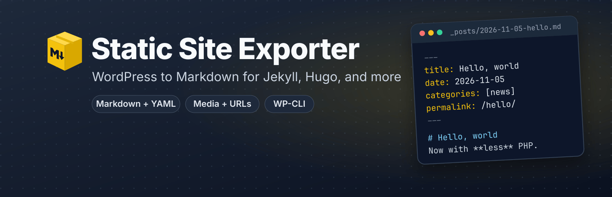

  
# Static Site Exporter

Export your WordPress posts and pages to Markdown in a couple of clicks, ready for Jekyll, Hugo, or any other static site generator.

   

## Features

* **One screen, no settings.** Choose *Export to Static Site* from the Tools menu, click Export, and download a zip. Nothing to configure first.
* **Your content, as Markdown.** Posts, pages, and drafts become Markdown files. Each one starts with its title, date, author, categories, tags, and custom fields.
* **Images come along.** Your uploaded images and files are included, and links to them keep working.
* **Jekyll, Hugo, Astro, or Eleventy.** Jekyll is the default; pick another generator and the export uses its folders and config.
* **Old links keep working.** On Jekyll, Hugo, and Eleventy, each post keeps its original web address.

## Usage

1. In your WordPress dashboard, go to **Plugins → Add New**, search for **Static Site Exporter**, then install and activate it.
2. Choose **Export to Static Site** from the **Tools** menu.
3. Pick your static site generator (Jekyll is the default), then click **Export**.
4. Unzip the download into your site. [Output formats](output-formats.md) says where each generator's files go.

That's it. Need more control? You can [export from the command line, pick which posts to export, include custom post types, and customize the output](advanced-usage.md).

## More information

* [Frequently asked questions](faq.md)
* [Advanced usage](advanced-usage.md)
* [Changelog](changelog.md)
* [Get help or report an issue](SUPPORT.md)
* [Help translate it into your language](https://translate.wordpress.org/projects/wp-plugins/jekyll-exporter/)
* [Contribute](CONTRIBUTING.md) or [develop locally](developing-locally.md)
